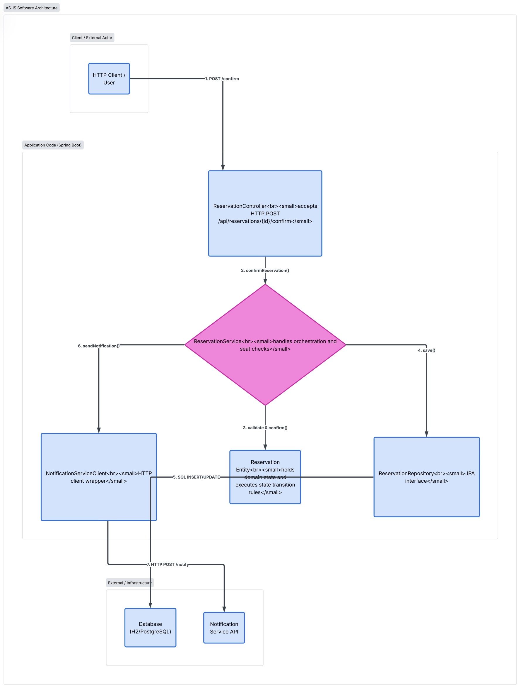

## A1. Scénář a související požadavky / pravidla

**Scénář / operace:** Confirm Reservation (`POST /reservations/{reservationId}/confirm`) 

**Požadavky:** 
- REQ-03 (Potvrzení rezervace)
- REQ-01 (Vytvoření rezervace)
- 
**Pravidla / invarianty:**
- BR-01 (Dvě potvrzené rezervace na stejné sedadlo a promítání se nesmí překrývat)
- BR-02 (Rezervaci lze potvrdit pouze ze stavu DRAFT)
- 
**Baseline:** v0.2

## A2. Mapování hlavního průchodu scénáře na kód

1. **Přijetí HTTP požadavku**:
   * **Kód**: `com.cinema.reservation.ScreeningController.confirmReservation(Long reservationId, RedirectAttributes redirectAttributes)`
   * **Popis**: Controller přijme HTTP POST požadavek na `/reservations/{reservationId}/confirm`.

2. **Načtení rezervace z databáze**:
   * **Kód**: `com.cinema.reservation.ReservationService.confirm(Long reservationId)` -> `ReservationRepository.findById(reservationId)`
   * **Popis**: Servis načte entitu `Reservation` podle ID. Pokud neexistuje, vrátí `ReservationService.Outcome` s neúspěchem.

3. **Kontrola stavu a obchodního pravidla (Invariant BR-02)**:
   * **Kód**: `com.cinema.reservation.ReservationService.confirm(Long reservationId)`
   * **Popis**: Service kontroluje, zda je aktuální stav `ReservationStatus.DRAFT`. Pokud ne, vrátí neúspěšný `ReservationService.Outcome`.

4. **Kontrola dostupnosti sedadel / překryvu (Invariant BR-01)**:
   * **Kód**: `com.cinema.reservation.ReservationService.blockedSeatIds(Long screeningId)`
   * **Popis**: Servisa ověří, zda vybraná sedadla (`ReservedSeat`) pro dané promítání (`Screening`) již nejsou blokována jinou potvrzenou rezervací.

5. **Změna stavu na CONFIRMED a perzistence**:
   * **Kód**: `com.cinema.reservation.ReservationService.allocateSeats(Reservation reservation, List<Long> requestedSeatIds)` -> `Reservation.setStatus(ReservationStatus.CONFIRMED)`
   * **Popis**: Stav rezervace je změněn na `CONFIRMED` a uložen do databáze.

6. **Odeslání notifikace (Externí závislost)**:
   * **Kód**: `—` (neimplementováno)
   * **Popis**: Notifikace po potvrzení rezervace nejsou v aktuální implementaci podporovány.

7. **Návrat odpovědi klientovi**:
   * **Kód**: `com.cinema.reservation.ScreeningController` -> `redirect:/reservations/{reservationId}`
   * **Popis**: Controller přesměruje uživatele na stránku s detailem rezervace.

## A3. Mapování doplňkové / chybové větve

**Chybová větev: Pokus o potvrzení již potvrzené nebo zrušené rezervace (Porušení BR-02)**

1. **Vstup**: Klient pošle požadavek na potvrzení rezervace, která má stav `CONFIRMED` nebo `CANCELLED`.
2. **Detekce chyby**:
   * **Kód**: `com.cinema.reservation.ReservationService.confirm(Long reservationId)`
   * **Mechanism**: Service zkontroluje `reservation.getStatus() != ReservationStatus.DRAFT` a vrátí `ReservationService.Outcome` s chybovou zprávou.
3. **Zpracování chyby**:
   * **Kód**: `com.cinema.reservation.ScreeningController.reservationRedirect(ReservationService.Outcome outcome, String successAttribute, String errorAttribute, RedirectAttributes redirectAttributes)`
   * **Výstup**: Neúspěšný výsledek je uložen jako flash atribut a uživatel je přesměrován na detail rezervace. Databáze zůstane nezměněna.


## A4. Seznam hlavních částí implementace

* **`ScreeningController`**: Server-rendered endpointy, zpracování formulářů a přesměrování.
* **`ReservationService`**: Aplikační logika a řízení transakcí pro vytváření, potvrzení, schválení, zamítnutí a zrušení rezervací.
* **`Reservation` (Domain Entity)**: Entita rezervace se stavem a požadovanými sedadly.
* **`ReservationRepository`**: Rozhraní Spring Data JPA pro perzistenci a dotazování nad entitou `Reservation`.
* **Notifikační služba**: Neimplementováno.

## A5. Stav, změna stavu a pravidlo

* **Kde je stav uložen**: Fyzicky v relaci DB tabulky `reservations` (sloupec `status`). V běžící aplikaci v doménové entitě `Reservation.status`.
* **Kdo rozhoduje o změně stavu**: `ReservationService` pomocí `Reservation.setStatus(ReservationStatus)`.
* **Kde se vynucuje business pravidlo (BR-01 / BR-02)**: 
  * Pravidlo stavového přechodu (BR-02) se vynucuje v `ReservationService.confirm(Long reservationId)`.
  * Pravidlo nepřípustnosti překryvu sedadel (BR-01) se vynucuje v `ReservationService` před změnou stavu.


## A6. Relevantní externí a perzistenční závislosti

| Závislost | Typ | Bod integrace v kódu | Použitá metoda / rozhraní |
| :--- | :--- | :--- | :--- |
| **Relační databáze (H2 / PostgreSQL)** | Perzistenční | `ReservationRepository` | Spring Data JPA (`findById`, `save`) |
| **Notification Service** | Neimplementováno | — | — |


## A7. Nakreslete AS-IS strukturální diagram




## A8. Architektonická otázka pro další návrh

> **Otázka**: Jakým způsobem zajistíme konzistenci a zabráníme race condition (souběžným požadavkům na potvrzení/rezervaci stejného sedadla na stejné promítání v jeden okamžik), pokud databázová kontrola v `ReservationService` probíhá na úrovni aplikační logiky bez použití pesimistického/optimistického zamykání nebo databázových unikátních indexů?


## C05 Detailed Design
Selected architecture unit:

Detailed responsibilities:

Design elements and ownership:

Key interface(s) / contract(s):

Focused structural view:

Detailed sequence:

Important methods / operations:

Algorithm / decision logic: (if relevant)

DD decisions intentionally left to code:


## C05 Detailed Design

**Selected architecture unit:** 
`Reservation Management` (Confirm Reservation Slice & Seat Allocation)

**Detailed responsibilities:**
- **Draft Validation:** Ověření, že vstupní požadavek je platný a rezervace existuje ve stavu `DRAFT`.
- **State Transition Control:** Řízení přechodu ze stavu `DRAFT` do `CONFIRMED`.
- **Future Screening Check:** Ověření, že se promítání odehrává v budoucnosti (podle BR-05).
- **Seat Availability & Conflict Enforcement:** Kontrola a zamezení překryvu sedadel (vynucení invariantu BR-01 / BR-02).
- **Persistence Coordination:** Uložení alokovaných sedadel a změny stavu do perzistentního úložiště.

**Design elements and ownership:**
| Responsibility | Owner | State/data | Why here? |
|---|---|---|---|
| **Draft & State Transition** | `Reservation` (Domain Entity) | `id`, `status` (`DRAFT`, `CONFIRMED`), `screeningId` | Doménová entita výhradně vlastní svá pravidla a stavy. |
| **Seat Allocation & Availability** | `SeatAvailability` (Service / Interface) | `reserved_seats` tabulka, časové sloty | Odděluje logiku alokace sedadel a kontrolu kolizí od kontroleru i perzistence. |
| **Transaction & Orchestration** | `ReservationService` | Transakční hranice | Koordinuje tok od HTTP požadavku přes doménu až po zápis do DB. |
| **Data Persistence** | `ReservationRepository` | Databázové záznamy | Poskytuje abstrakci nad databázovým uložištěm (Spring Data JPA). |

**Key interface(s) / contract(s):**

public interface SeatAvailability {
    AllocationResult allocateSeats(Long screeningId, List<Long> seatIds, Long reservationId);
}


**Contract:**

- **Preconditions:**
  - `screeningId` a `seatIds` jsou platné a nejsou prázdné.
  - Promítání se odehrává v budoucnosti (odvozeno z BR-05).
  - Rezervace je aktuálně ve stavu `DRAFT`.

- **Postcondition:**
  - `AllocationResult` obsahuje potvrzení o úspěchu.
  - Všechna požadovaná sedadla z `seatIds` jsou exkluzivně a trvale zapsána pro dané `screeningId` a `reservationId`. Žádný jiný proces je nemůže alokovat.

- **Failures:**
  - `SEAT_ALREADY_TAKEN` (Porušení BR-02 / BR-01: o alokaci se ve stejný čas pokusil někdo jiný a byl rychlejší).
  - `INVALID_INPUT` (Sedadlo v daném sále vůbec neexistuje).

**Focused structural view:**


**Detailed sequence:**
- **1.** `ScreeningController` přijme POST požadavek na `/reservations/{id}/confirm`.
- **2.** Zavolá se `ReservationService.confirm(reservationId)`.
- **3.** `ReservationService` načte entitu `Reservation` pomocí `ReservationRepository`.
- **4.** Provede se validace stavu a ověření budoucího promítání (BR-05) na entitě `Reservation`.
- **5.** `ReservationService` deleguje alokaci sedadel na rozhraní `SeatAvailability.allocateSeats(screeningId, seatIds, reservationId)`.
- **6.** Pokud jsou sedadla volná, proběhne zápis do databáze a stav rezervace se přepne na `CONFIRMED`. V případě kolize se vyhodí výjimka `SEAT_ALREADY_TAKEN`.

  **Important methods / operations:**

| Metoda / Operace | Zodpovědnost | Vstupní parametry | Návratová hodnota / Výjimka |
| :--- | :--- | :--- | :--- |
| `SeatAvailability::allocateSeats` | Ověření dostupnosti a exkluzivní blokace sedadel | `screeningId`, `seatIds`, `reservationId` | `AllocationResult` / `SEAT_ALREADY_TAKEN` |
| `Reservation::confirm` | Přechod stavu rezervace z `DRAFT` na `CONFIRMED` | — (interní stav entity) | `void` / `IllegalStateException` |
| `ReservationService::confirm` | Orchestrace celého procesu potvrzení rezervace | `reservation2Id` (Long) | `Reservation` / výjimka |

**Algorithm / decision logic:**

Následující algoritmus zajišťuje ověření dostupnosti sedadel, zamezení souběžných konfliktů (vynucení pravidel BR-01 a BR-02)[cite: 1, 2] a případné schválení administrátorem pro velká skupinová rezervování (více než 10 míst):

```java
public AllocationResult allocateSeats(Long screeningId, List<Long> seatIds, Long reservationId) {
    // 1. Ověření, zda se promítání koná v budoucnosti a sedadla existují (BR-05)
    validateScreeningAndSeats(screeningId, seatIds);

    // 2. Kontrola kolizí (BR-01 / BR-02): Zjištění, zda již nejsou sedadla obsazena jinou potvrzenou rezervací
    List<Long> blockedSeats = reservationRepository.findAlreadyReservedSeats(screeningId, seatIds);
    if (!blockedSeats.isEmpty()) {
        throw new SeatAlreadyTakenException("SEAT_ALREADY_TAKEN: Sedadla " + blockedSeats + " jsou již obsazena.");
    }

    // 3. Pravidlo pro velké skupiny: pokud je vybráno více než 10 míst, vyžaduje se schválení administrátorem
    if (seatIds.size() > 10) {
        reservationRepository.updateStatus(reservationId, ReservationStatus.REQUIRES_APPROVAL);
        return new AllocationResult(false, "REQUIRES_APPROVAL");
    }

    // 4. Úspěšná exkluzivní alokace a trvalý zápis do databáze
    reservationRepository.saveAllReservedSeats(screeningId, seatIds, reservationId);
    return new AllocationResult(true, "SUCCESS");
}

**DD decisions intentionally left to code:**
- **Infrastruktura a HTTP vrstva:** Konfigurace Spring MVC anotací (`@RestController`, `@PostMapping`), mapování URL endpointů a mapování výjimek na HTTP status kódy v globálním handleru.
- **Formátování odpovědí a serializace:** Převod doménových objektů na JSON/HTML odpovědi a struktura chybových hlášení pro klientské rozhraní.
- **Technická správa spojení a transakční detaily:** Nastavení connection poolů pro databázi (HikariCP), definice transakčních timeoutů a technické detaily logování (`SLF4J`).
- **Validace na úrovni API DTO:** Technické formátovací validace vstupních dat pomocí anotací Bean Validation (`@NotNull`, `@Size`), které doplňují hlavní doménová pravidla (BR-01, BR-02, BR-05).
