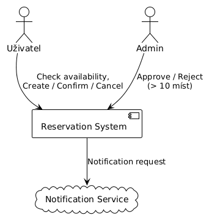
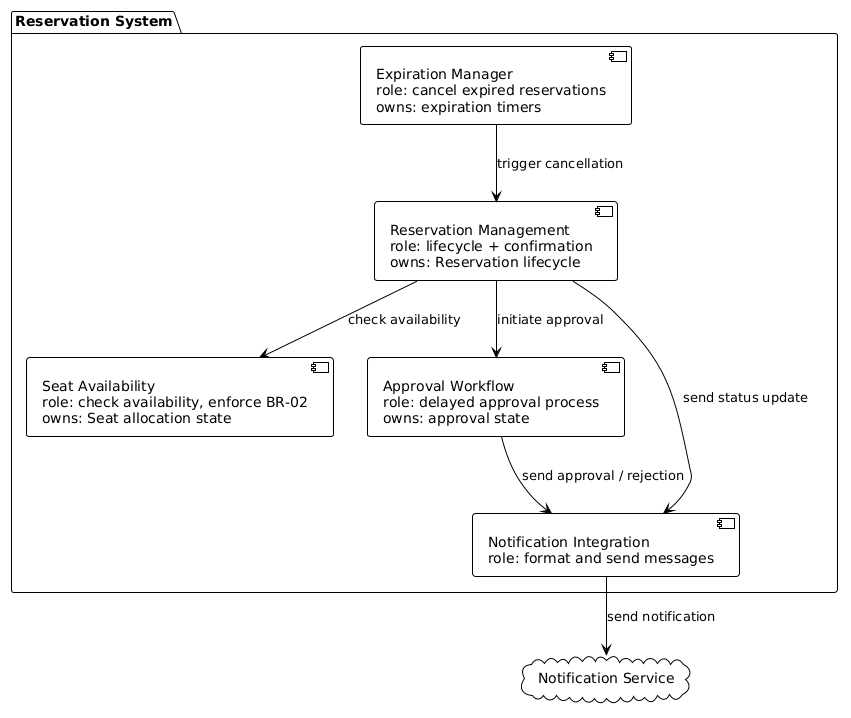
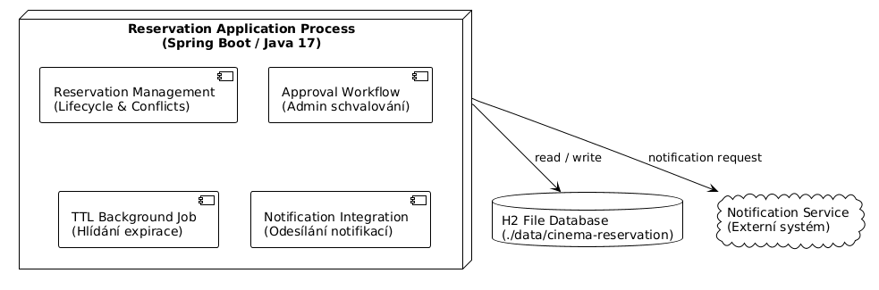

#Architectural Views (G)

##G1 - Context diagram

##G2 - To-Be diagram

##G3 - Ownership přechodů
| Přechod                       | Owner rozhodnutí         | Kdo může transition pouze vyžádat |
|-------------------------------|--------------------------|-----------------------------------|
| DRAFT -> PENDING_APPROVAL     | [Reservation Management] | Zákazník (Uživatel)               |
| PENDING_APPROVAL -> CONFIRMED | [Approval Workflow]      | Admin                             |
| PENDING_APPROVAL-> REJECTED   | [Approval Workflow]      | Admin                             |

##G4 - Runtime/Deployment mapping

