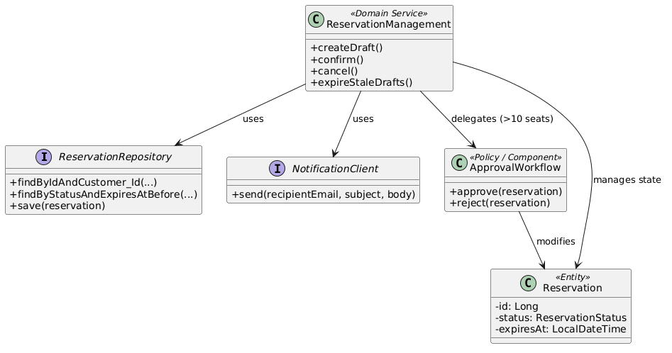

# Detailed Design
## Selected architecture unit / responsibility: Reservation lifecycle

Related requirement(s): 
- REQ-01 system vytvori DRAFT normalni rezervace ro existujici sedadla, kdyz pozadovany interval sedadel je volny
- REQ-03: Systém změní stav rezervace z DRAFT na CONFIRMED a trvale zapiše alokaci sedadel pro dané promítání.
- REQ-05 — Approve / Reject Reservation (Admin Approval)
  
Related scenario(s): OP-01 (CREATE), OP-03 (CONFIRM), OP-04 (CANCEL), OP-05 (APPROVE / REJECT)

Relevant business rule(s):
- BR-02 — Exclusive Resource invariant At no committed system state may two CONFIRMED Reservations overlap for the same exclusive Resource.
- BR-03 — Cancellation policy [team-defined, domain-specific accepted policy]
- BR-04 — Domain-specific rule from C01 [team-defined] Zruseni rezervace je mozne do 30 minut pred promitanim
- BR-05 — Only future change Uzivatel muze vytvorit/upravit/zrusit rezervaci pouze na budouci promitani

## SubResponsibilities
| Detailed responsibility                                                                                                                     | Why is it needed?                                                                                                                                                     |
|---------------------------------------------------------------------------------------------------------------------------------------------|-----------------------------------------------------------------------------------------------------------------------------------------------------------------------|
| Draft creation — validace vstupů a promítání, vytvoření DRAFT s TTL, bez alokace sedadel                                                    | Základní stav Rezervace — zaznamená uživatelův záměr (REQ-01) a odděluje výběr sedadel od jejich trvalé alokace (BR-02 se kontroluje až při potvrzení)                |
| Draft expiry — detekce prošlých DRAFTů (lazy při přístupu + eager přes background job) a přechod DRAFT -> EXPIRED                           | Sedadla držená v DRAFT nesmí blokovat rezervace jiných uživatelů donekonečna; TTL (15 minut) zaručuje, že se nevyužité záměry uvolní                                  |
| Confirmation — ověření čerstvosti DRAFT a budoucnosti promítání, rozhodnutí přímé potvrzení vs. schválení adminem, spuštění alokace sedadel | Dokončuje nákupní proces (REQ-03); DRAFT -> CONFIRMED (<= 10 míst) nebo DRAFT -> PENDING_APPROVAL (> 10 míst, C02); BR-02 a BR-05 se musí ověřit před zápisem alokace |
| Cancellation — kontrola stavu a 30minutového deadline, idempotentní opakované zrušení, uvolnění sedadel                                     | Umožňuje uživateli odstoupit od záměru (OP-04); BR-03 idempotence, BR-04 deadline, BR-05 budoucí promítání; uvolněná sedadla se zpřístupní ostatním                   |
| Admin validation — schválení/zamítnutí PENDING_APPROVAL (> 10 míst), uvolnění sedadel při rejectu                                           | Řízeno změnovou kartou C02 (REQ-05); PENDING_APPROVAL -> CONFIRMED (sedadla zůstávají) nebo -> REJECTED (sedadla se uvolní); REJECTED je terminální stav              |


## 3 - Design elements and ownership (Struktura a data)

| Responsibility | Owner | State/data | Why here? |
|---|---|---|---|
| **Draft creation** | `ReservationManagement` | `Reservation` (stav DRAFT, TTL, screeningId) | Hlavní orchestrátor životního cyklu. Zaznamená uživatelův záměr a odděluje výběr od trvalé alokace. |
| **Draft expiry** | `ReservationManagement` (příp. `ExpirationManager`) | `Reservation` (přechod na EXPIRED) | Hlídá časové limity (15 min TTL), aby nevyužité záměry neblokovaly sedadla donekonečna. |
| **Confirmation** | `ReservationManagement` a `SeatAvailability` | `Reservation` (CONFIRMED / PENDING), `AllocatedSeat` | `ReservationManagement` řídí proces a změnu stavu. `SeatAvailability` je zavolána k trvalému zápisu alokace a garantuje BR-02 (zabraňuje overbookingu). |
| **Cancellation** | `ReservationManagement` a `SeatAvailability` | `Reservation` (stav CANCELLED) | `ReservationManagement` hlídá 30minutový deadline a idempotenci. Pokud je storno úspěšné, zavolá `SeatAvailability` pro uvolnění sedadel. |
| **Admin validation** | `ApprovalWorkflow` | `Reservation` (přechod z PENDING na CONFIRMED / REJECTED) | Striktně odděluje admin schvalování (REQ-05) od běžného toku. Při REJECTED se postará o uvolnění sedadel. |


### Key interface(s) / contract(s)

`<<interface>> ReservationRepository`

`findByStatusAndExpiresAtBefore(status: ReservationStatus, time: LocalDateTime) : List<Reservation>`

**Contract:**

**Preconditions:**
- `status` je platný stav rezervace (např. ReservationStatus.DRAFT).
- `time` je platné časové razítko (aktuální čas systému).

**Postcondition:**
- Vrací seznam všech rezervací v daném stavu, jejichž čas `expiresAt` je starší než zadaný čas `time`.
- Nemění stav databáze (read-only vyhledávací operace).

**Failures:**
- `DATABASE_UNAVAILABLE` (výpadek spojení s databází – transakce se neprovede a vyvolá se výjimka).
- `INVALID_ARGUMENT` (pokus o předání null hodnoty do parametrů).


### Focused UML structural view



## 4 - Important operation decisions
### OP-01 — Create Reservation

Operation: POST /screenings/{screeningId}/reservations\
Responsibility: Draft creation\
Input: screeningId, jméno a email zákazníka, požadovaná sedadla (requested seat IDs)\
Output: ID nové rezervace ve stavu DRAFT, přesměrování na detail rezervace\
Preconditions: promítání existuje a je v budoucnosti (BR-05); zákazník nemá na dané promítání jinou aktivní rezervaci; požadovaná sedadla existují v sále; počet sedadel je v povoleném rozsahu\
Postconditions: existuje nová Reservation ve stavu DRAFT s createdAt/expiresAt (TTL 15 minut); requestedSeatIds jsou držena v rámci DRAFT; žádné záznamy v reserved_seat\
Side effects: nic — sedadla nejsou ještě alokována (BR-02 se kontroluje až při potvrzení); běží časovač TTL draftu\
Failure behavior: ReservationRuleException s uživatelskou zprávou; žádná rezervace se nevytvoří (nevalidní počet sedadel, chybějící kontaktní údaje, proběhlé promítání, duplicitní aktivní rezervace)\


### OP-03 — Confirm Reservation

Operation: POST /reservations/{reservationId}/confirm\
Responsibility: Confirmation\
Input: reservationId\
Output: aktualizovaný stav rezervace — CONFIRMED (<= 10 míst) nebo PENDING_APPROVAL (> 10 míst, C02)\
Preconditions: rezervace existuje; Reservation.state == DRAFT; draft nevypršel (TTL); promítání ještě nezačalo (BR-05); požadovaná sedadla jsou stále volná (BR-02)\
Postconditions: rezervace je ve stavu CONFIRMED nebo PENDING_APPROVAL; alokace sedadel je trvale zapsána do reserved_seat (v obou případech); sedadla se počítají jako obsazená\
Side effects: sedadla se stanou nedostupnými pro ostatní uživatele (seat map i kapacita na výpisu promítání); u > 10 míst se rezervace objeví v admin panelu k schválení\
Failure behavior: reject se zprávou pro uživatele; prošlý draft přechází do EXPIRED; konflikt sedadel (BR-02) -> reject beze změny stavu; jiný stav než DRAFT -> reject beze změny\


### OP-04 — Cancel Reservation

Operation: POST /reservations/{reservationId}/cancel\
Responsibility: Cancellation\
Input: reservationId\
Output: stav rezervace CANCELLED (nebo potvrzení beze změny při idempotentním opakování)\
Preconditions: rezervace existuje; Reservation.state v {DRAFT, PENDING_APPROVAL, CONFIRMED}; do začátku promítání zbývá alespoň 30 minut (BR-04); promítání je v budoucnosti (BR-05)\
Postconditions: rezervace je ve stavu CANCELLED; záznamy v reserved_seat jsou smazány; sedadla jsou opět volná a rezervovatelná\
Side effects: uvolněná sedadla se zpřístupní ostatním uživatelům (seat map, kapacita)\
Failure behavior: již CANCELLED -> idempotentní úspěch (BR-03); REJECTED/EXPIRED (terminální) -> reject; méně než 30 minut do začátku -> reject (BR-04)\


### OP-05 — Approve / Reject Reservation (Admin)

Operation: POST /admin/reservations/{reservationId}/approve | /reject (VALIDATE_RESERVATION)\
Responsibility: Admin validation\
Input: reservationId, rozhodnutí admina (Approve/Reject), přihlášená admin session\
Output: stav rezervace CONFIRMED (Approve) nebo REJECTED (Reject)\
Preconditions: admin je přihlášen (session admin/admin); rezervace existuje; Reservation.state == PENDING_APPROVAL (tj. > 10 míst, C02)\
Postconditions: Approve -> CONFIRMED, alokace sedadel zůstává beze změny; Reject -> REJECTED (terminální), záznamy v reserved_seat se mažou a sedadla se uvolňují\
Side effects: výsledek rozhodnutí se odesílá uživateli přes NotificationIntegration (3 pokusy; selhání notifikace se pouze loguje)\
Failure behavior: stav mimo PENDING_APPROVAL -> reject beze změny; nepřihlášený uživatel -> přesměrování na domovskou stránku, operace se neprovede; souběh (Cancel mezitím / dvě rozhodnutí) -> první operace proběhne, druhá je odmítnuta; selhání notifikace nikdy nevrací rozhodnutí zpět\

### BR-02 — Exclusive Resource invariant (allocateIfAvailable)

```
function allocateIfAvailable(screeningId, requestedSeats, reservation):
    begin transaction
    heldSeats = seats of CONFIRMED and PENDING_APPROVAL reservations for screeningId
    if requestedSeats intersect heldSeats:
        rollback
        throw "seats already taken"
    insert ReservedSeat(reservation, seat) for each seat in requestedSeats
    commit
    // race: DB unique constraint (screening_id, seat_id) blocks the loser
```


### OP-03 — Confirm Reservation

```
function confirm(reservationId):
    r = findById(reservationId)
    if r is null: throw "not found"
    if r.state == DRAFT and now > r.expiresAt:
        r.state = EXPIRED
        save(r)
        throw "draft expired"
    if r.state != DRAFT: throw "cannot confirm"
    if now >= r.screening.startTime: throw "screening already started"   // BR-05
    allocateIfAvailable(r.screeningId, r.requestedSeats, r)              // BR-02
    r.state = (count(r.requestedSeats) > 10) ? PENDING_APPROVAL : CONFIRMED
    save(r)
```


### OP-04 — Cancel Reservation

```
function cancel(reservationId):
    r = findById(reservationId)
    if r is null: throw "not found"
    if r.state == CANCELLED: return OK                       // BR-03 idempotent
    if r.state in {REJECTED, EXPIRED}: throw "cannot cancel" // terminal
    if now >= r.screening.startTime - 30 min: throw "cancel deadline"   // BR-04, BR-05
    r.state = CANCELLED
    delete reservedSeats of r
    save(r)
```


### Draft expiry — DRAFT -> EXPIRED (TTL 15 min)

```
every 60 seconds:                          // eager, ExpirationManager
    for r in drafts where expiresAt < now:
        r.state = EXPIRED
        save(r)

// lazy: same check before render detail / confirm
```


### OP-05 — Approve / Reject (admin)

```
function decide(reservationId, decision):
    if not adminLoggedIn: redirect home
    r = findById(reservationId)
    if r is null: throw "not found"
    if r.state != PENDING_APPROVAL: throw "cannot decide"
    if decision == APPROVE:
        r.state = CONFIRMED                 // seats stay allocated
    else:
        r.state = REJECTED                  // terminal
        delete reservedSeats of r
    save(r)
    try sendOutcomeNotification(r, decision)   // 3 attempts
    catch e: log(e)                           // never reverts the decision
```

### Detailed sequence

Architectural level:
```
API → Reservation Management → Availability → Persistence
```

Detailed Design level:
```
ScreeningController → ReservationManagement → SeatAvailability → ReservationRepository
```

## 5 — Odvoďte unit/component testy z DD

### Přehled odvozených testů

| DD element / decision | What must hold? | Test level | Test case |
|---|---|---|---|
| Interface contract (`SeatAvailability`) | Úspěšně alokuje sedadla pro platný screening, neprázdný seznam a DRAFT rezervaci | unit / component | `testAllocateSeatsSuccess()` |
| Algorithm branch (BR-02 / conflict) | Vyhodí chybu `SEAT_ALREADY_TAKEN`, pokud se o alokaci pokusil jiný proces dříve | component / unit | `testAllocateSeatsAlreadyTakenThrowsException()` |
| Precondition / validation | Vyhodí `INVALID_INPUT`, pokud požadované sedadlo v daném sále neexistuje | unit | `testAllocateSeatsInvalidSeatThrowsException()` |
| Future screening check (BR-05) | Odmítne alokaci pro promítání, které se neodehrává v budoucnosti | unit | `testAllocateSeatsPastScreeningFails()` |
| Collaboration (`ReservationService` + `SeatAvailability`) | Zajistí transakční alokaci sedadel a propojení s konkrétní rezervací | integration | `testServiceAllocatesSeatsAndPersists()` |

### Detailní zdůvodnění vybraných testů

#### 1. Test pro Algorithm branch (`SEAT_ALREADY_TAKEN` / BR-02)
* **Selected level:** Component / Unit test
* **Why this level:** Pravidlo zamezení duplicitní alokace stejného sedadla pro stejný screening je klíčovým invariantem rezervačního systému[cite: 1, 2, 3]. Test ověřuje, že při souběžném pokusu o alokaci systém správně zachytí konflikt, zabrání dvojité rezervaci a vrátí očekávaný chybový stav.
* **What design decision does this test verify?** Ověřuje dodržení kontraktu rozhraní `SeatAvailability` a odolnost vůči race conditions (konfliktním zápisům) na úrovni alokace sedadel.

#### 2. Test pro Precondition / Invalid Input (`INVALID_INPUT`)
* **Selected level:** Unit test
* **Why this level:** Ověření vstupních podmínek (preconditions) zajišťuje, že systém selže včas a bezpečně předtím, než se pokusí pracovat s neexistujícími daty v databázi[cite: 3]. Unit test isolovaně prověří reakci na neplatná ID sedadel.
* **What design decision does this test verify?** Ověřuje splnění předpokladů rozhraní `SeatAvailability` a správné ošetření neplatných vstupních parametrů.
